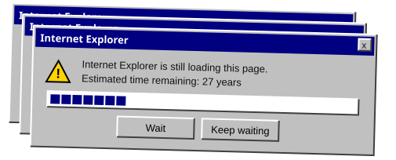
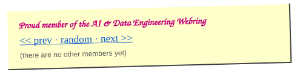
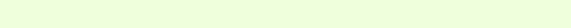

<picture><source media="(prefers-color-scheme: dark)" srcset="./assets/intro-dark.svg"></picture>

---&gt; check out my repo: <a href="https://github.com/iremmozel/power-bi-data-flow">power-bi-data-flow</a> 🔥 HOT!

<picture><source media="(prefers-color-scheme: dark)" srcset="./assets/powered-by-dark.svg"></picture>

 <a href="https://github.com/iremmozel/iremmozel/issues?q=is%3Aissue+Guestbook+in%3Atitle">(add a new entry)</a>

| Name | Date | Message |
| :--- | :--- | :--- |
| [your name] | [today] | Nobody has signed yet. Be the first. |

<picture><source media="(prefers-color-scheme: dark)" srcset="./assets/counter-dark.svg"></picture>

<picture><source media="(prefers-reduced-motion: reduce)" srcset="./assets/marquee-static.svg"></picture>

<em>Last updated: whenever the build passed. Best experienced at 800x600.</em>

